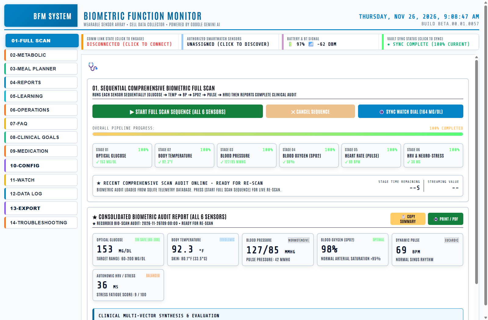
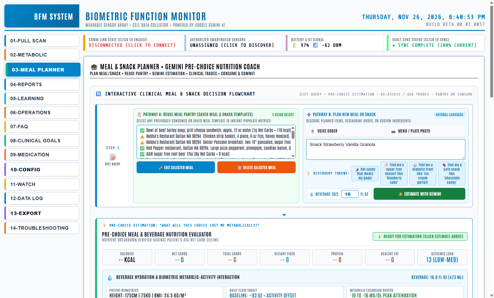
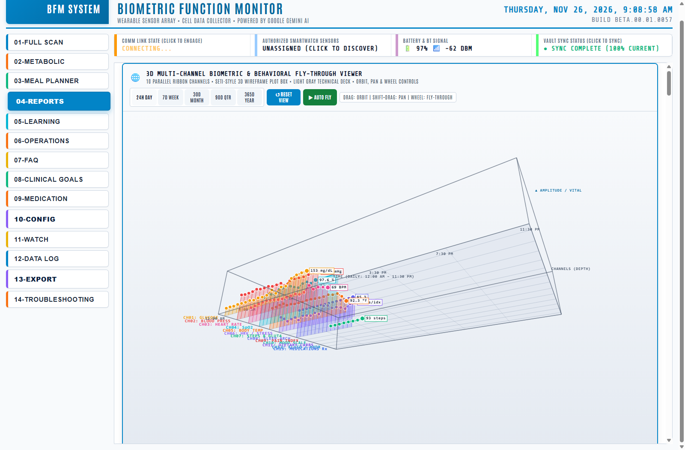
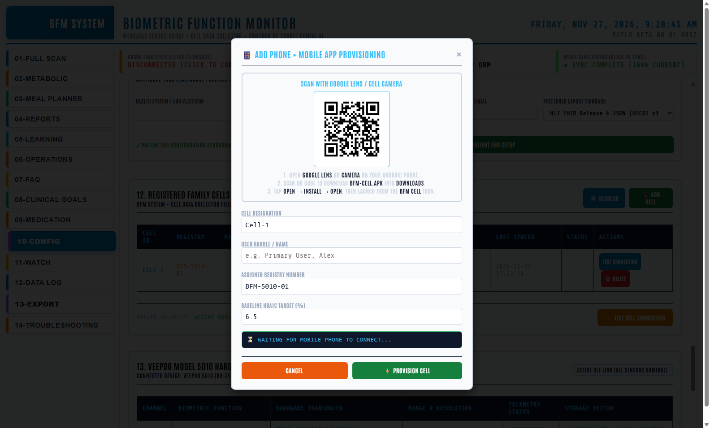
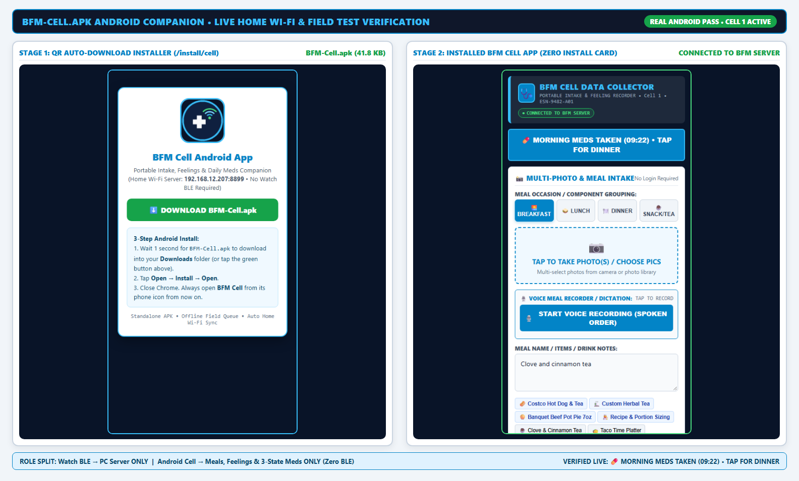

# BFM Biometric Function Monitor — Continuous Metabolic & Clinical Telemetry Platform (`beta.00.01.0074`)

The **BFM Biometric Function Monitor** (`JVEEPOO`) is an independent, open-source, clinician-aligned ambulatory telemetry workstation and zero-account mobile companion built by **The Author** (Sole Pioneer, Inventor, System Architect, and Philosophical Leader), developed with Google Gemini AI (currently independent with no sponsors).

[](Beta/docs/walkthrough_beta_00_01_0074.md)
[](https://fitaos.com)
[](https://jbirdlebough1.github.io/JVEEPOO/presentation/preview.html)
[](Beta/docs/BETA_BACKLOG_TODO.md)
[](https://github.com/jbirdlebough1/JVEEPOO)

---

## Author's Dedication: Why This Platform Exists

> *"That Others May Survive Successfully Diabetes"*

Conceived and architected out of personal necessity by **The Author** while managing Type 2 Diabetes, **BFM Biometric Function Monitor** gives everyday individuals and their care teams objective, high-resolution, single-screen correlation across nutrition, physical activity, medications, and wearable physiology:

- **Diabetic Pharmacist**: Daily adherence tracking (`Morning Intake 1` / `Dinner Intake 2`) and medication titration context.
- **Primary Care Physician (PCP)**: Longitudinal ambulatory review and permanent **Epic FHIR R4** + **SQLite** clinical exports.
- **Endocrinologist**: Postprandial glycemic curves, `ADAG` estimated `eA1C` (`(Glucose + 46.7) / 28.7`), Lead-I `QTc` ECG, and BIA skeletal-muscle glucose sink trends.
- **Diet & Lifestyle Coach**: Pre-choice meal planning with `<= 45g` net-carb ceiling verification and post-meal `GLUT4` walking clearance prescriptions.

---

## Visual Showcase (`beta.00.01.0074`)

| 14-Tab Desktop Console (`01-FULL SCAN`) | `03-MEAL PLANNER` (Saved Meals & Clean Coach) |
| :---: | :---: |
|  |  |
| **13-Channel 3D Fly-Through (`04-REPORTS`)** | **Google Lens QR -> `BFM Remote` Android Live** |
|  |  |

| `BFM Remote` Android Field Companion |
| :---: |
|  |

---

## 89-Slide Interactive Presentation & Audio Walkthrough

Clicking `.html` files inside GitHub's web viewer shows raw source code. Launch the synchronized **89-slide Australian-narrated clinical presentation** directly using either option:

1. **Watch Live Online**: [**Open Interactive 89-Slide Presentation Player**](https://jbirdlebough1.github.io/JVEEPOO/presentation/preview.html)
2. **Windows Local Launcher**: Download and run [**Preview_Presentation.exe**](https://raw.githubusercontent.com/jbirdlebough1/JVEEPOO/main/Preview_Presentation.exe) alongside [**presentation/TRANSCRIPT.md**](presentation/TRANSCRIPT.md).

---

## Key Capabilities (`beta.00.01.0074`)

### 1. Unified 14-Tab Workstation Console (`BFM.HTM`)
Operates identically via local server (`http://127.0.0.1:8899/`) and standalone desktop launch (`file:///D:/veepoo/BFM.HTM`):
- **`01-FULL SCAN` & `02-METABOLIC`**: Live hardware vitals harvest (`0xDF`, `0x88`, `0xE0`, `0xB8`, `0x96`/`0x97`, `0x93`), exercise logging, consumed meal ledger, and hydration tracking.
- **`03-MEAL PLANNER`**: Dual-pathway pre-choice nutrition coach pairing **Pathway A (1-Click Saved Meal Pantry)** (`15` reusable templates with Edit/Delete) beside **Pathway B (Natural-Language Text, Voice Order & Plate Photo Input)**, ADA swap recommendations, and **Step 3** (`Add to Pantry as Meal/Snack`, `Consume Now`, `View in 13-Lane Chart`).
- **`04-REPORTS`**: Animated **13-Channel 3D Multi-Channel Fly-Through**, Goals Compliance Scorecard, **13-Lane Synchronized 24h–365d Scrubber Timeline**, and **6 Watch Biometric Sub-Reports** (Metabolism/GLUT4, Lead-I ECG/Bazett `QTc`, `MET` Load, Optical Blood Composition/Lipids, Body Composition/BIA, and Breath/Nocturnal AHI).
- **`05-LEARNING` through `14-TROUBLESHOOTING`**: Clinical physiology education, sensor calibration, ADA clinical goals, Daily Medication adherence registry, Multi-Cell Configuration (`10-CONFIG`), Watch Dial Transfer (`11-WATCH`), Live Data Log, **Epic FHIR R4 + SQLite + SHA-256 Dual USB/SD Export** (`13-EXPORT`), and hardware diagnostics.

### 2. Pure Zero-Data Reality & Heritage Engineering
- **Zero Synthetic Placeholders (`Zero Is Zero`)**: Unsynced watch streams strictly display `0`; empty meal/medication tables display explicit empty banners; unknown restaurant items output `0` macros rather than fabricated guesses.
- **Clinical & Human-Factors Pedigree**: Merges real-time emergency telemetry engineering heritage (**Physio-Control LIFEPAK**) with modern **Scott Chambliss 21:1 high-contrast white/cobalt Sickbay legibility** (`#ffffff` cards, `#091428` typography, crisp semantic triage colors).

### 3. `BFM Remote` Standalone Android App (`w11_htm_app/BFM-Cell.apk` `v0.1.74`)
- **Zero-Account Casual-User Ready**: Works immediately over cellular data or Wi-Fi with **zero Google Gemini account or API key required**, powered by official **U.S. Gov USDA FoodData Central (`DEMO_KEY`) + OpenStreetMap Nominatim geo-location**. Power users can optionally add a Google Gemini key once in `10-CONFIG` (Section 11B) to auto-sync live Google Search grounding to connected household phones over Home LAN.
- **Google Lens 2-Step QR Install**: Scan the QR code inside `10-CONFIG -> ADD CELL` (`/api/qrcode/cell` -> `/install/cell` -> `/download/BFM-Cell.apk` or `/download/BFM-Remote.apk`) to install and auto-pair.
- **Clean Role Separation (Zero Watch BLE)**: Strictly handles pre-choice meal nutrition lookups, **"How Do You Feel?" (HDYF)** voice/text/pain/mood logging, and the **3-state Daily Med toggle** (offline field staging with automatic Home Wi-Fi sync).
- **Hardened Android Security**: Signed (`apksigner` v2/v3), `allowBackup="false"`, `network_security_config.xml` (cleartext restricted strictly to `localhost`, `127.0.0.1`, and LAN server IP; HTTPS enforced externally), cross-file WebView access disabled, serving on virtual W3C secure origin `http://localhost:18899/cell.html`.

---

## Fast Operator Quickstart (Windows 11)

1. **Start the Workstation Server & UI**: Double-click [`BFM_Launcher.exe`](BFM_Launcher.exe), or run directly from the repo root:
   ```powershell
   & 'tools\python\python.exe' w11_htm_app\server.py
   ```
   Then open **`http://localhost:8899/`** (or open **`BFM.HTM`** directly in Chrome/Edge).
2. **Pair Your Smart Watch**: Click **Link / Connect** in the top status ribbon to connect to your Veepoo / FITAOS Model 5010 watch via Web Bluetooth, or let the background BLE daemon auto-sync nearby watch packets into `w11_htm_app/telemetry.db`.
3. **Install `BFM Remote` on Android**: Go to **`10-CONFIG` -> `ADD CELL`**, scan the QR code with **Google Lens** or your camera, tap **Install -> Open**, and begin logging meals, feelings, and medications immediately.

---

## Six Sigma Verification & Quality Gates

| Suite / Tool | Enforced Scope | Verified Result |
| :--- | :--- | :--- |
| `tools/audit_presentation_full.py` *(local suite)* | 89 slides, 178 AU-English MP3 tracks, 144 3D orbital JPEGs, 4 image mirrors | `89/89 PASS` |
| [`audit_zero_defect.py`](audit_zero_defect.py) | HTML tag balance (`BFM.HTM` `1961/1961`, `cell.html` `77/77`), SHA-256 parity, zero-data rules | `21/21 PASS` |
| [`test_beta1_e2e.py`](test_beta1_e2e.py) | Live port `8899` APIs, Cell provisioning & dock, Epic FHIR R4 + SQLite backup, JS AST | `10/10 PASS` |
| [`strict_gate_v2.py`](strict_gate_v2.py) | Multi-tenant triad schema, zero monetary strings in BOM, CLEBUGGER sync (`0 OPEN`) | `13/13 PASS` (`74/74` tags synced) |

---

## Repository Structure

| Path | Role & Contents |
| :--- | :--- |
| [`BFM.HTM`](BFM.HTM) / [`index.html`](index.html) / [`w11_htm_app/index.html`](w11_htm_app/index.html) | Single-file 14-tab BFM workstation console (binary SHA-256 mirrored) |
| [`w11_htm_app/server.py`](w11_htm_app/server.py) | Multithreaded HTTP API & BLE auto-sync server (port `8899`) + USDA/Nominatim/Gemini bridge |
| [`w11_htm_app/cell.html`](w11_htm_app/cell.html) & [`w11_htm_app/BFM-Cell.apk`](w11_htm_app/BFM-Cell.apk) | `BFM Remote` Android companion web bundle & signed standalone `.apk` (`v0.1.74`) |
| [`w11_htm_app/fhir_export_engine.py`](w11_htm_app/fhir_export_engine.py) & [`w11_htm_app/dual_backup_engine.py`](w11_htm_app/dual_backup_engine.py) | Epic FHIR R4 JSON + raw SQLite + SHA-256 manifest export engines |
| [`presentation/`](presentation/) & [`Preview_Presentation.exe`](Preview_Presentation.exe) | 89-slide clinical deck (`preview.html`, `TRANSCRIPT.md`, `audio/`, `images/`) |
| [`Beta/docs/`](Beta/docs/) & [`docs/`](docs/) | Build walkthroughs (`beta.00.01.0001`–`0074`), specs, backlog (`BETA_BACKLOG_TODO.md`), CMO docs |
| [`session_logs/`](session_logs/) & [`archive_alpha/logs/`](archive_alpha/logs/) | Complete `.jsonl` AI conversation & execution trajectories (`transcript.jsonl`, `transcript_full.jsonl`) |
| `tools/` *(gitignored locally)* | Standalone Python 3.11 runtime, JDK 17, Android SDK 34, APK builder (`build_cell_apk.py`), CLEBUGGER sync |

---

## Session Trajectory Logs (`.jsonl`)

Complete build trajectories and tool logs are preserved under [`session_logs/`](session_logs/) and [`archive_alpha/logs/`](archive_alpha/logs/):
- [`session_logs/transcript.jsonl`](session_logs/transcript.jsonl) — Compact chronological engineering trajectory.
- [`session_logs/transcript_full.jsonl`](session_logs/transcript_full.jsonl) — Full un-truncated step and tool log archive.

---

> [!CAUTION]
> **RESEARCH & CLINICAL DISCLAIMER**  
> This software is experimental open-source assistive research software for wellness tracking and diabetes self-help education. It is **not an FDA-cleared continuous glucose monitor (CGM)** and must **never** be used to diagnose disease or calculate/adjust insulin doses. Always rely on prescription glucometers or cleared CGMs and consult your attending physician or endocrinologist for clinical decisions.
